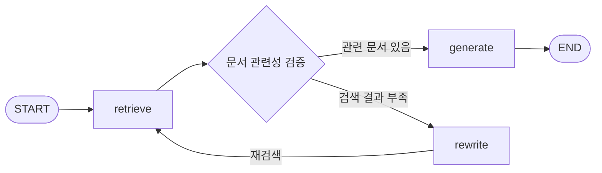
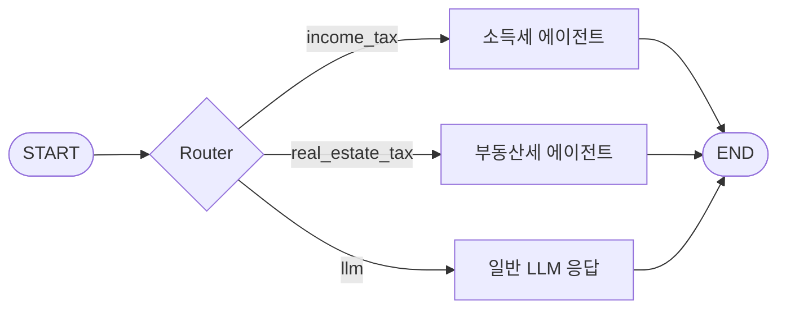

# LangGraph Agent

법 문서를 기반으로 질문에 답하는 로컬 LLM 기반 RAG 및 멀티 에이전트 데모 프로젝트이다. 
법률 문서가 사내 문서와 가장 유사하다.

LangGraph로 문서 검색, 관련성 평가, 질문 재작성, 답변 검증을 연결하고, 질문의 유형에 따라 소득세 에이전트·부동산세 에이전트·일반 응답 모델로 실행 경로를 나눈다. Ollama로 모델과 임베딩을 로컬에서 실행하고, Chroma에 문서 벡터를 저장한다.

현재 실행 단위는 Jupyter Notebook이다. 별도의 웹 서비스나 CLI 애플리케이션은 구현되어 있지 않으며, `main.py`는 기본 진입점 예제이다.
추후 FastAPI를 활용해 에이전트를 서빙하고, 유저가 API를 통해 세법 질의응답 기능을 활용할 수 있도록 디벨롭할 예정이다.

## 주요 기능

- **문서 기반 질의응답**: 세법 문서를 분할하고 임베딩하여 관련 문서를 검색한다.
- **Agentic RAG**: 검색 결과가 부족하면 질문을 재작성하고 다시 검색한다.
- **Self-RAG**: 답변의 문서 근거와 질문에 대한 유용성을 평가한다.
- **Corrective RAG**: 로컬 검색 결과가 부적절하면 웹 검색으로 보완한다.
- **Adaptive Routing**: 질문에 따라 문서 검색, 웹 검색, 일반 LLM 응답을 선택한다.
- **병렬 처리와 멀티 에이전트**: 부동산세 계산에 필요한 정보를 병렬로 수집하고, 세목별 그래프를 서브그래프로 재사용한다.
- **Tool Calling**: 모델이 선택한 덧셈·곱셈 도구를 실행하고 결과를 모델에 전달한다.

## 구성 기술

| 구분 | 기술 | 역할 |
| --- | --- | --- |
| 실행 환경 | Python 3.12, Jupyter Notebook, uv | 개발 환경과 노트북 실행 |
| 워크플로 | LangGraph | 상태 관리, 조건부 분기, 병렬 실행, 서브그래프 |
| 모델 연동 | LangChain, langchain-ollama | 프롬프트, 모델 호출, 출력 파싱 |
| 로컬 추론 | Ollama | 생성 모델과 임베딩 모델 실행 |
| 벡터 저장소 | Chroma | 문서 벡터 저장과 유사도 검색 |
| 웹 검색 | Tavily | 외부 검색 결과 수집 |
| 프롬프트 | LangSmith Client | 공개 RAG·평가 프롬프트 조회 |
| 문서 처리 | PyPDFLoader, Unstructured, BeautifulSoup | PDF·Markdown·텍스트 로딩과 전처리 |

### 사용 모델

외부 LLM API 호출 비용을 고려해, 현재는 Ollama로 생성 모델과 임베딩 모델을 로컬에서 실행한다. 추후 프로젝트를 발전시키면서 외부 LLM 서비스의 API 키를 발급받아 연동할 예정이다.

| 모델 | 사용 목적 |
| --- | --- |
| `bge-m3` | 한국어 문서와 질문의 임베딩 |
| `exaone3.5:7.8b` | 문서 기반 답변 생성과 평가 |
| `qwen3:4b` | 멀티 에이전트 라우팅, 일반 질문 응답, Tool Calling |

`bge-m3`는 임베딩 모델이며 대화 생성용 모델이 아니다. 모델별 실제 설정은 각 노트북을 기준으로 한다.

## 프로젝트 구조

```text
langgraph-agent/
├── documents/
│   ├── income_tax.pdf
│   ├── real_estate_tax.pdf
│   └── output_docs/
│       ├── income_tax.md
│       ├── income_tax.txt
│       └── real_estate_tax.md
├── modules/
│   ├── income_tax_graph.py
│   └── real_estate_tax_graph.py
├── notebook/
│   ├── 1.langchain_vs_langgraph.ipynb
│   ├── 2.retrieval_agent.ipynb
│   ├── 3.rewrite_agentic_rag.ipynb
│   ├── 4.self-rag.ipynb
│   ├── 5.corrective-rag.ipynb
│   ├── 6.adaptive-rag.ipynb
│   ├── 7.parallel-agent.ipynb
│   ├── 8.multi-agent.ipynb
│   └── tool_calling/
│       └── 1. how_to_use_tools_langchain.ipynb
├── income_tax_collection/          # 로컬에서 생성하는 소득세 벡터 DB
├── real_estate_tax_collection/     # 부동산세 벡터 DB
├── main.py
├── pyproject.toml
└── uv.lock
```

## 워크플로

### 문서 검색과 재검색

3번 노트북의 흐름이다. 관련성 검증은 `retrieve` 이후 실행되는 조건부 라우팅 함수이다.



Self-RAG에서는 생성된 답변의 근거와 유용성을 추가로 평가한다. 현재 4번 노트북과 소득세 모듈은 문서 관련성 평가에서 부적절하다고 판단하면 종료하고, 답변이 유용하지 않다고 판단하면 질문을 재작성한다.

### 멀티 에이전트 라우팅

8번 노트북은 시작 지점의 라우팅 함수가 질문을 분류해 다음 경로 중 하나를 선택한다. 아래 `Router`는 이 조건부 분기를 표현한다.



## 실행 준비

### 1. Python 환경

Python 3.12와 [uv](https://docs.astral.sh/uv/)를 준비한 후, 프로젝트 루트에서 실행한다. 아래 명령은 Windows PowerShell 기준이다.

```powershell
uv sync
```

**현재 `pyproject.toml`에는 `pip`와 개발용 `ipykernel`만 선언되어 있다.** 따라서 `uv sync`만으로는 노트북 실행에 필요한 패키지가 모두 설치되지 않는다. 생성된 `.venv`에 런타임 패키지를 추가로 설치한다.

```powershell
uv pip install langgraph langchain-ollama langchain-chroma langchain-core langchain-classic langchain-text-splitters
uv pip install langchain-community langchain-tavily langsmith pydantic python-dotenv typing-extensions
uv pip install "unstructured[md]" markdown beautifulsoup4 pypdf nest-asyncio
```

추가 설치한 패키지는 현재 `uv.lock`에 기록되지 않는다. 정확한 환경 재현을 위해서는 이후 런타임 의존성을 `pyproject.toml`에 등록하고 잠금 파일을 갱신해야 한다. 이 준비 절차에서는 설치 후 `.venv`의 Python을 직접 사용한다.

VS Code에서 `.venv`를 노트북 커널로 선택한다. 커널 목록에 별도로 등록하려면 다음 명령을 실행한다.

```powershell
.\.venv\Scripts\python.exe -m ipykernel install --user --name langgraph-agent --display-name "langgraph-agent (Python 3.12)"
```

### 2. Ollama 모델

[Ollama](https://ollama.com/)를 설치하고 필요한 모델을 내려받는다.

```powershell
ollama pull bge-m3
ollama pull exaone3.5:7.8b
ollama pull qwen3:4b
ollama list
```

Ollama 서버의 기본 주소는 `http://localhost:11434`이다. 백그라운드 서비스가 실행 중이 아니라면 `ollama serve`로 서버를 시작한다. 모델 크기와 컨텍스트 설정에 따라 RAM·VRAM 사용량과 응답 시간이 달라진다.


## 노트북 실행

### 작업 디렉터리

세법 노트북과 모듈은 `../documents`, `../income_tax_collection` 등 **현재 작업 디렉터리를 기준으로 하는 상대 경로**를 사용한다. `notebook/`을 작업 디렉터리로 실행해야 의도한 경로를 찾는다.

```python
from pathlib import Path

print(Path.cwd())  # 프로젝트의 notebook 디렉터리인지 확인
```

## Chroma DB 재사용

`Chroma.from_documents(...)`는 기존 컬렉션이 있다고 해서 반드시 오류를 발생시키지 않는다. 같은 내용을 다시 저장해도 ID가 다르면 별도 레코드가 추가될 수 있다.

이미 생성한 DB를 검색에만 사용하려면 다음처럼 연결한다. 아래 코드는 `notebook/` 작업 디렉터리 기준이다.

```python
from langchain_chroma import Chroma
from langchain_ollama import OllamaEmbeddings

embeddings = OllamaEmbeddings(
    model="bge-m3",
    base_url="http://localhost:11434",
)

vector_store = Chroma(
    collection_name="income_tax_collection",
    persist_directory="../income_tax_collection",
    embedding_function=embeddings,
)

retriever = vector_store.as_retriever(search_kwargs={"k": 3})
```

- 동일 문서를 재적재할 때는 안정적인 문서 ID와 중복 방지 정책이 필요하다. (현재 미구현)
- 현재 `modules/real_estate_tax_graph.py`는 import 과정에서 `Chroma.from_documents(...)`를 실행한다. 새 커널에서 다시 import하면 문서가 추가될 수 있다.
- 임베딩 모델을 변경하면 기존 벡터를 그대로 재사용하지 말고 해당 모델로 문서를 다시 임베딩해야 한다.
- PDF·Markdown 파싱 결과 자체에 반복되는 내용이 있을 수 있으므로, 레코드 중복과 원문 반복을 구분해야 한다.

## 현재 범위와 주의 사항

- 노트북 중심 구현이며, 자동화된 전체 실행 테스트와 서비스 배포 구성은 포함되어 있지 않다. (추후 디벨롭할 예정이다)
- 일부 모듈은 import 시 문서 로딩, DB 적재, 외부 프롬프트 조회(hub에서 pull하는 방식)를 실행한다. 실행과 초기화의 분리는 향후 개선 대상이다.
- PDF 표·OCR·문서 분할의 오류나 LLM의 계산 오류가 답변에 반영될 수 있다. 현재 부동산세 계산도 LLM 호출을 포함하며, 검증된 결정적 계산 엔진은 아니다.

## 공식 문서

- [LangGraph 개요](https://docs.langchain.com/oss/python/langgraph/overview)
- [LangChain ChatOllama 연동](https://docs.langchain.com/oss/python/integrations/chat/ollama)
- [Ollama Tool Calling](https://docs.ollama.com/capabilities/tool-calling)
- [uv 가상환경 관리](https://docs.astral.sh/uv/pip/environments/)
